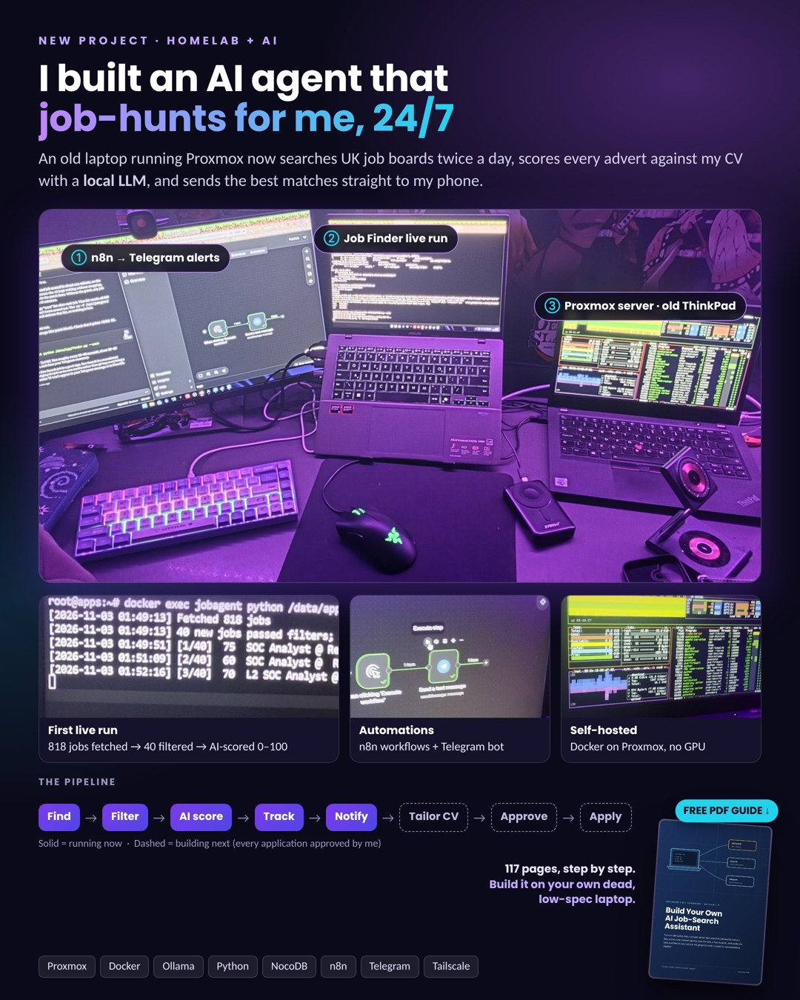

# AI Job Agent (Part 1: Job Finder)



**Free guides:** [117-page beginner handbook (PDF)](docs/AI-Job-Agent-Handbook.pdf) · [Quick start (PDF)](docs/Quick-Start-Guide.pdf) · [Testing report](docs/Testing-Report.pdf)

**Download the install package:** [ai-job-agent.zip (latest release)](../../releases/latest)

A self-hosted assistant that searches job boards (UK via Reed + Adzuna; Poland
via Adzuna plus the free solid.jobs API, the Jooble aggregator and JustJoin.it
through Apify - both optional and skipped without keys; remote roles via the
Himalayas API) twice a day, scores every
advert against your own profile with an AI model, saves the good matches
to a tracker and sends you a Telegram summary.

Scoring runs on a local Ollama model by default (free, private, no GPU-heavy
requirements needed beyond a modest machine). Alternatively set
`AI_PROVIDER=mistral` in `.env` to score with the Mistral API instead — no
local AI stack needed at all, at the cost of sending job advert text to
Mistral's servers.

It runs on an old laptop or mini PC (Proxmox + one Linux container + Docker).
With Ollama it needs no graphics card and no paid AI service; with the
Mistral provider it works on even smaller machines but needs internet access
and a Mistral API key.

> **What it does NOT do (yet):** it does not rewrite your CV, does not ask for
> approval and does not apply for jobs. Those are planned parts 2-4. You apply
> yourself, using the links it sends you.

The full beginner's handbook (PDF) explains every step from an empty computer.
This README is the short version for people who already know Linux and Docker.

## What is in this package

```
ai-job-agent/
├── install.sh                  installer (run INSIDE the container/VM as root)
├── README.md                   this file
├── host/
│   └── setup-nat-bridge.sh     optional: Network Option B, run on the Proxmox HOST
├── dockge/compose.yaml         optional web UI for Docker stacks   -> /opt/dockge
├── stacks/
│   ├── ai/compose.yaml         Ollama + Open WebUI                 -> /opt/stacks/ai
│   ├── jobs/compose.yaml       NocoDB (+ n8n, Gotenberg extras)    -> /opt/stacks/jobs
│   └── jobagent/
│       ├── Dockerfile          python:3.12-slim + requests         -> /opt/stacks/jobagent
│       ├── compose.yaml
│       └── .env.example        copy to .env and fill in (chmod 600)
└── jobagent/                                                       -> /opt/jobagent
    ├── app/finder.py           the Job Finder program
    ├── app/config.json         search keywords, filters, schedule, threshold
    ├── cv/master.md            YOUR true profile (template - replace it)
    ├── cv/answers.yaml         YOUR fixed form answers (for planned part 4)
    ├── tools/get_chat_id.py    prints your Telegram chat ID
    ├── tools/check_setup.py    tests Reed, Adzuna, solid.jobs, Himalayas, Jooble, JustJoin, AI, NocoDB, Telegram
    ├── state/                  seen.json + run.log are created here
    └── output/                 reserved for tailored CVs (planned part 2)
```

## Quick install

```bash
# inside a Debian 12/13 or Ubuntu 22.04/24.04 container or VM, as root
apt update && apt install -y unzip
unzip ai-job-agent.zip && cd ai-job-agent
bash install.sh               # or: bash install.sh --minimal   (4-8 GB RAM)
```

Then:

1. NocoDB (`http://YOUR_SERVER_IP:8081`): create base **Job Agent**, table
   **Applications** with the fields listed in the handbook, and an API token.
2. Telegram: create a bot with @BotFather, send it "hello".
3. `nano /opt/stacks/jobagent/.env` - fill in every `YOUR_...` value.
4. `docker exec jobagent python /data/tools/get_chat_id.py` (after step 3 + restart).
5. `nano /opt/jobagent/cv/master.md` - replace the example with your real profile.
6. `cd /opt/stacks/jobagent && docker compose up -d --force-recreate`
7. `docker exec jobagent python /data/tools/check_setup.py --send`
8. First run in the background:
   `docker exec -d jobagent sh -c "python /data/app/finder.py --once >> /data/state/run.log 2>&1"`
   and follow it with `tail -f /opt/jobagent/state/run.log`.

## Everyday commands

| Task | Command |
|---|---|
| Run once now (foreground) | `docker exec jobagent python /data/app/finder.py --once` |
| Watch scheduler | `docker logs -f jobagent` |
| After editing config.json or master.md | `docker restart jobagent` |
| After editing .env | `cd /opt/stacks/jobagent && docker compose up -d --force-recreate` |
| Forget all processed jobs | `rm /opt/jobagent/state/seen.json` |
| Status of everything | `docker ps` |

## Ports

| Port | Service | Notes |
|---|---|---|
| 8081 | NocoDB tracker | required |
| 3000 | Open WebUI | optional chat UI |
| 5001 | Dockge | optional |
| 5678 | n8n | optional, `--profile extras` |
| 11434 | Ollama | bound to 127.0.0.1 only (no password) |

## Switching the AI: Ollama (default) or Mistral API

Scoring is pluggable via `.env` (`/opt/stacks/jobagent/.env`):

| | Ollama | Mistral API |
|---|---|---|
| Set | `AI_PROVIDER=ollama` | `AI_PROVIDER=mistral` |
| Model examples | `qwen2.5:3b`, `llama3.1:8b` | `mistral-small-latest`, `open-mistral-nemo` |
| Extra secret needed | none (`OLLAMA_URL`) | `MISTRAL_API_KEY` from [console.mistral.ai](https://console.mistral.ai) |
| Runs on | your server (AI stack) | Mistral's cloud (nothing local) |
| Privacy | adverts never leave your server | advert text is sent to Mistral |

`SCORING_MODEL` must match the active provider. After switching, run
`cd /opt/stacks/jobagent && docker compose up -d --force-recreate` and then
`docker exec jobagent python /data/tools/check_setup.py` to verify the
provider. When `mistral` is active, the Ollama stack (AI stack) is optional.

## Security

* Never share, screenshot or commit `/opt/stacks/jobagent/.env` (this includes
  `MISTRAL_API_KEY`).
* Do not expose any of these ports to the internet; use Tailscale for remote access.
* The AI may only rephrase what is in `master.md`; it must never invent experience.
* Any future auto-apply feature must ask for approval for every application.

## Status

Part 1 (find, filter, AI-score, track, notify) works. Parts 2-4 (tailored CVs,
Telegram approve buttons, guarded auto-apply) are planned; see chapter 19 of the
handbook. Issues and pull requests are welcome.

## Licence

MIT - see [LICENSE](LICENSE).
